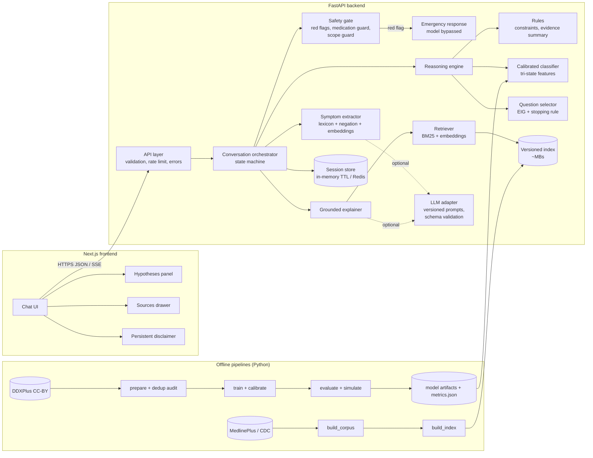
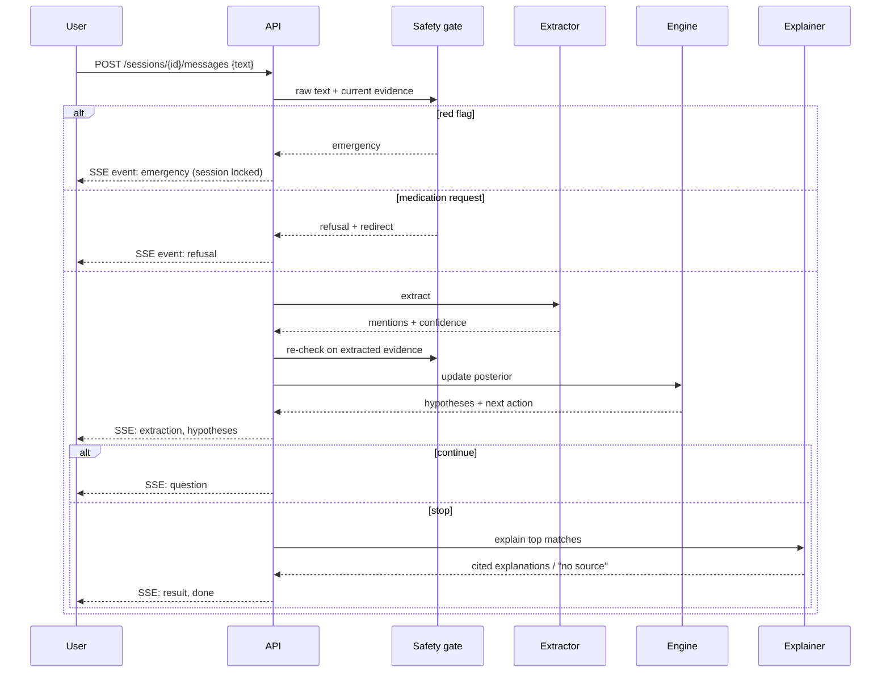

# Phase 0 Plan: Symptom Reasoning Assistant

Status: **awaiting approval**. No application code changes until approved.

Contents
1. Audit of the current repository
2. Dataset and model decision
3. Architecture
4. API contract
5. Folder structure
6. Evaluation plan
7. Safety plan
8. Privacy and data flow
9. Phased milestones and acceptance criteria
10. Requested changes that are unsafe or a bad idea, with alternatives
11. Open questions

---

## 1. Audit of the current repository

Scope: every tracked file at commit `e4c474f` (13 Python modules, 4 CSVs, README, requirements).

### 1.1 Measured data problem: the reported accuracy is pure leakage

`data/dataset.csv` (Kaggle "Disease Symptom Description" dataset) has 4,920 rows, 41 diseases, exactly 120 rows each. Measured in this audit:

| Check | Result |
|---|---|
| Unique rows | **304 of 4,920** (4,616 exact duplicates) |
| Symptom sets mapping to >1 disease | 0 (classes are perfectly separable) |
| Test rows in the original 80/20 random split that are identical to a train row | **100%** |
| RandomForest, original random split | top-1 1.000, top-3 1.000 |
| RandomForest, deduplicated split (76 test rows) | top-1 1.000, top-3 1.000 |
| RandomForest, deduplicated split, test cases reduced to 3 present symptoms | top-1 0.737, top-3 0.895, mean max-prob 0.358 |

Interpretation: each disease is a fixed symptom template with one symptom dropped per row. Any classifier memorizes the 41 templates. The dataset cannot measure real diagnostic performance, and the only non-trivial signal (partial presentations) is still synthetic. Several disease names are misspelled or padded (`"Diabetes "`, `"Hypertension "`, `Osteoarthristis`, `Peptic ulcer diseae`, `Paroymsal`); three symptom strings differ between `dataset.csv` and `Symptom-severity.csv` by stray spaces. Licence of the Kaggle source is not stated in the repository and could not be confirmed.

### 1.2 Bugs (verified by reading the code)

| # | Location | Problem |
|---|---|---|
| B1 | `src/train_rf_model.py:31-37`, `117-122` | Default dataset path is `dataset.csv` / `../dataset.csv`; data lives in `data/`. `python run_training.py` from the repo root raises `FileNotFoundError`. |
| B2 | `src/train_xgb_model.py:189-193` | Same path bug; also imports `symptom_normalizer` without a `sys.path` fix, so it only runs from inside `src/`. No entrypoint trains XGBoost. |
| B3 | `src/ensemble_predictor.py:4,568` | Imports `get_predictor` from `xgb_predictor` but passes `rf_model_path="models/rf_model.pkl"`. The "XGBoost" loader loads the RandomForest pickle. XGBoost is never used at runtime. |
| B4 | `src/ensemble_predictor.py:611` | `final_score = rule * (1 + alpha * rf)` clipped to 1. `beta` is accepted and never used. Output is labelled `confidence` but is not a probability (does not sum to 1, not calibrated). |
| B5 | `src/rf_predictor.py:458`, `src/xgb_predictor.py:535` | Ad-hoc tempering (`p**0.7`, `p**0.8`) with no calibration evidence. |
| B6 | `src/tree_of_thoughts.py:151-175` | "yes" adds `severity/10` to the score; "no" multiplies by 0.6; result is capped at **0.9**. This cap is the source of the README's "90.0% confidence". The update is arithmetic, not probabilistic, and a "no" can be undone by `max(score, rule_score)`. |
| B7 | `src/tree_of_thoughts.py:184-205` | An answer only updates hypotheses whose own question list contained that symptom; other hypotheses ignore the evidence. `asked` is tracked per hypothesis, so the same symptom can be asked again later via another hypothesis. |
| B8 | `src/interactive_loop.py:300,351` | Each iteration calls `diagnose()` again, which rebuilds the tree from scratch. All "no" answers are lost; only "yes" answers survive (appended to the symptom list). Negative evidence never affects the ranking. |
| B9 | `src/tree_of_thoughts.py:231` | `literature_supported = matched_count >= 4` is a symptom count, not literature support. |
| B10 | `src/symptom_normalizer.py:110-137` | Embedding match at cosine ≥ 0.45 with no negation handling: "no fever" normalizes to a fever symptom. No ambiguity handling (closest match always wins). `lru_cache` on an instance method keeps the instance alive. |
| B11 | README example | Input shown as `'high, fever'`, `'chest, pain'`: evidence of comma-splitting on the CLI path. |
| B12 | `src/symptom_normalizer.py:28,77-79` | Debug `print`; writes `models/canonical_symptoms.json` as a side effect of construction (fails on read-only filesystems). |
| B13 | `rag_pubmed_retriever.py:23-26` | Disease filter uses substring match of each disease word in MeSH text. For `hepatitis A` the word `a` matches every document; for `Heart attack`, `heart` matches all cardiology. Linear scan of every document per query. |
| B14 | `src/main_pipeline.py:443-450`, `src/tree_of_thoughts.py:54` | Literature search runs for every ranked disease and again per hypothesis for question selection: dozens of full linear scans per turn. Exceptions are swallowed, so a missing index silently produces no sources. |
| B15 | `test_tot.py`, `tester.py`, `rag_explainer.py` | Root scripts import `main_pipeline` without adding `src/` to the path: `ImportError`. They are interactive scripts, not tests. |
| B16 | `src/tree_of_thoughts.py:11` | Default paths `dataset.csv` differ from `get_tot` defaults; module singletons (`get_scorer`, `get_normalizer`) ignore arguments after first construction. |
| B17 | `src/rf_predictor.py:464` | `inverse_transform` called once per class per prediction. |
| B18 | `src/train_rf_model.py:145-177` | Test split is created and never evaluated; comment states accuracy is "not meaningful". |

### 1.3 Risks

- **Safety**: output headline is "FINAL DIAGNOSIS ... 90% confidence". `Heart attack` and `Paralysis (brain hemorrhage)` are ranked like any other class instead of triggering escalation. No red-flag handling, no disclaimer in output.
- **Medication exposure**: `rag_explainer.py` extracts RxNorm drug names from abstracts and returns them next to a suspected disease. This reads as a treatment suggestion.
- **Unsafe advice in data**: `symptom_precaution.csv` contains items such as "avoid non veg food" for malaria. Must not be surfaced.
- **Licensing**: full `RXNCONSO.RRF` is distributed under the UMLS licence (not redistributable). PubMed abstracts are publisher-copyrighted; a redistributed abstract index is not clearly permitted. README claims MIT but there is no `LICENSE` file.
- **Security**: `pickle.load` of model files (arbitrary code execution if an artifact is replaced).
- **Reproducibility**: unpinned `requirements.txt`; the 6 GB PubMed index has no build manifest; `sentence-transformers` pulls PyTorch (~1–2 GB image), which does not fit most free hosts.
- **Engineering**: `sys.path` manipulation, cwd-dependent paths, global singletons, `print` logging, no tests, no CI, no type hints.

### 1.4 Gaps versus the goal

No API (README references `api_server.py`, deleted in `ac9e735`), no frontend (UI removed in `78919d7`), no free-text extraction beyond one-symptom-per-argument, no calibration, no evaluation, no grounding check, no session model, no privacy design.

---

## 2. Dataset and model decision

### 2.1 Options considered

| Option | Size / scope | Licence | Verdict |
|---|---|---|---|
| Current Kaggle CSV | 304 unique rows, 41 diseases, 131 binary symptoms | Not stated in repo; unconfirmed | Retire as a training source. Keep only as a documented leakage example in the evaluation report. |
| **DDXPlus** (Mila, NeurIPS 2022) | ~1.3M synthetic patients, 49 pathologies, 223 evidences (208 binary, 10 categorical, 5 multi-choice), age, sex, initial evidence, ground-truth differential, per-condition severity; official 80/10/10 split; English release since 2023 | CC-BY | **Recommended.** |
| MIMIC-IV / clinical notes | Real data | Credentialed access, no redistribution, not symptom-structured | Rejected: cannot be shipped in a public demo. |
| SNOMED CT / UMLS vocabularies | Terminology | Licence required | Rejected for the shipped system. |
| Symptom–disease graphs scraped from the web | Varies | Usually unclear | Rejected. |

### 2.2 Why DDXPlus, and its honest limits

Advantages:
- Large enough for a real held-out evaluation and for calibration on a separate validation split.
- Contains **negative and categorical evidence** (pain location, character, intensity), which an adaptive interview needs.
- `INITIAL_EVIDENCE` per patient models the user's opening complaint, enabling a realistic interview simulator.
- Per-condition `severity` field enables model-driven urgency escalation in addition to hard red-flag rules.
- CC-BY permits redistribution of derived artifacts with attribution.

Limits that will be stated in the README and model card:
- **Synthetic**: generated from a proprietary knowledge base by a commercial rule-based system. Accuracy on DDXPlus measures agreement with that knowledge base, not clinical accuracy.
- **Scope shift**: the 49 conditions are mainly respiratory, cardiac, ENT and a few systemic conditions. Dermatological, hepatic, urinary and many GI conditions in the current dataset are not covered. The assistant must say when input appears out of scope.
- Many conditions are emergencies (e.g. pulmonary embolism, unstable angina, possible NSTEMI/STEMI, anaphylaxis, epiglottitis, spontaneous pneumothorax). These are handled by escalation, not ranked as "possible matches" next to a cold.
- Published results used the French release; the English release is reported equivalent but not independently verified. Some translated evidence wording may need clean-up for user-facing questions.
- Synthetic patients are likely to repeat identical evidence sets across splits. The pipeline deduplicates on `(pathology, sex, age band, evidence set)` across splits and reports metrics on the deduplicated test set alongside the official split.

### 2.3 Explanation corpus

| Source | Licence | Use |
|---|---|---|
| **MedlinePlus health-topic XML** (NLM) | Health-topic summaries are US federal works, public domain; attribution to MedlinePlus.gov requested. A.D.A.M. encyclopedia and ASHP drug monographs are copyrighted and **excluded**. | Primary corpus. |
| CDC condition pages | US federal works, public domain (individual third-party images excluded) | Secondary, for conditions missing from MedlinePlus. |
| NHS website | OGL v3.0 plus NHS-specific terms (mandatory attribution wording; adapted text must not be attributed to the NHS; API use requires accepting syndication terms) | Optional. Requires reviewing current NHS syndication terms before inclusion. |
| WHO fact sheets | CC BY-NC-SA 3.0 IGO | Excluded by default (NC + SA complicate the repo licence). |
| PubMed abstracts | Publisher copyright | Excluded from the shipped corpus. Wrong audience for an educational tool and not clearly redistributable. |

Corpus design: a fixed list of source URLs per condition, pinned by retrieval date and SHA-256 of the raw file, stored in `corpus/sources.lock.json`. Text is chunked (≈150–300 words) and committed as `corpus/corpus.jsonl` (public-domain text only). The index is a ~1–5 MB set of files (`embeddings.npy`, `bm25.json`, `manifest.json` with corpus hash, embedding model ID and version). `make index` rebuilds it byte-identically from the lock file. Conditions without an acceptable source show "No reviewed source available for this condition" instead of generated text.

### 2.4 Model design

The probabilistic core is a classifier over DDXPlus conditions with **tri-state features** (present / absent / not asked) plus age band and sex.

- Training uses **evidence masking**: for each training patient, random subsets of evidence are hidden (with the initial evidence always kept), so the model learns posteriors for partial interviews, which is what it sees at runtime. A model trained only on complete evidence vectors treats "not asked" as "absent" and is badly miscalibrated mid-interview.
- Candidates, compared on validation **NLL under masked evidence**: (a) multinomial logistic regression (baseline), (b) gradient-boosted trees (XGBoost `hist`, already a dependency), (c) a Naive-Bayes model with smoothed empirical likelihoods `P(evidence | condition)` (interpretable and needed anyway for answer prediction in question selection). The RandomForest is dropped (poor calibration, large artifacts).
- **Calibration**: temperature scaling on the validation split as the primary method (one parameter, preserves ranking, robust for 49 classes). Isotonic one-vs-rest and vector scaling are evaluated as comparisons; the one with the best validation NLL/ECE is shipped and the choice is recorded in the model card.
- **Abstention**: a calibrated threshold on top-1 probability and on the top-1/top-2 margin, chosen from the risk–coverage curve on validation. Below it the assistant asks more questions or recommends a clinician.
- **Rules layer** (kept from the hybrid design, with a clearer role): red-flag rules (bypass), hard constraints (e.g. sex-specific conditions, age plausibility), and evidence summaries ("consistent with / against") for display. The current additive severity score is not mixed into probabilities.
- **Question selection** (replaces the current heuristic "Tree-of-Thoughts"): expected information gain. For each unasked evidence `e`, `P(answer | state) = Σ_c P(c | state) · P(e | c)`, posterior per hypothetical answer from the calibrated model (one batched prediction for all candidates), EIG = current entropy − expected posterior entropy. Categorical evidence is asked as a single multiple-choice question. Optional cost term down-weights sensitive or hard-to-answer questions.
- **Stopping rule**: stop when any holds: (1) top-1 calibrated probability ≥ τ and margin ≥ m; (2) max EIG < ε; (3) question budget reached (default 12); (4) red flag fired; (5) user ends. Outcome is "possible matches" if (1), otherwise "uncertain: see a clinician" with the current list shown as low-confidence.
- Model artifacts are serialized with `skops` (or XGBoost JSON + NumPy arrays), not `pickle`, and verified by SHA-256 at load.

### 2.5 Free-text extraction

Interface `SymptomExtractor.extract(text, context) -> ExtractionResult` with per-mention `evidence_id`, `polarity` (present/absent), `value` (for categorical), `span`, `confidence`.

Default deterministic implementation (no external API, no PyTorch):
1. Text normalization (case, punctuation, common misspellings via a small edit-distance dictionary).
2. Lexicon matcher: curated synonyms per evidence (lay terms, e.g. "can't catch my breath" → shortness of breath), generated from DDXPlus question text plus manual additions, stored as versioned YAML.
3. Negation and uncertainty scoping (NegEx-style triggers: "no", "not", "denies", "without", "never had").
4. Embedding fallback: `all-MiniLM-L6-v2` via ONNX Runtime (`fastembed`, ~90 MB, no PyTorch) matching sentence fragments to evidence descriptions.
5. Confidence policy: high → accepted silently and shown as chips the user can remove; medium → confirm ("Did you mean chest pain?"); low or ambiguous between ≥2 candidates → clarifying question with options; none → ask the user to rephrase and show examples.

Optional LLM extractor behind the same interface (see 3.3).

---

## 3. Architecture

### 3.1 Component diagram



### 3.2 Turn sequence



### 3.3 LLM usage (optional, off by default)

- Interface `LLMClient.complete_json(prompt_id, version, variables, schema) -> Model | None`.
- Prompt templates in `backend/app/llm/prompts/<name>/v<N>.txt`, with version recorded in every response's metadata.
- Uses: (a) extraction from long or messy free text, output validated against the evidence catalogue (unknown IDs dropped); (b) rephrasing retrieved passages into plain language, accepted only if every sentence cites a retrieved chunk ID and passes a lexical-overlap check against that chunk.
- Never used for: red-flag decisions, probabilities, question choice, or anything about medication.
- Timeouts, one retry, then the deterministic path. `/health` reports `llm: disabled | available | degraded`.
- Provider is chosen by config; the demo runs fully without an API key.

### 3.4 Session state machine

`created → collecting → questioning → (result | uncertain | emergency | expired)`. `emergency` is terminal for the session; the user can start a new session. State: evidence map, asked question IDs, posterior history, turn count, flags. No free text is stored in state after extraction (only evidence IDs and short spans for UI chips, held in memory).

---

## 4. API contract

Base path `/api/v1`. All bodies JSON, validated by Pydantic; unknown fields rejected. Errors use `{"error": {"code": str, "message": str, "request_id": str}}`.

| Method & path | Body | Response |
|---|---|---|
| `GET /health` | – | `200 {status, version, model_version, index_version, llm}` |
| `GET /meta` | – | `200 {conditions: [{id, name, severity}], evidence_count, metrics_summary, disclaimer}` |
| `POST /sessions` | `{age_band?: "0-4"\|...\|"65+", sex?: "female"\|"male"\|"unspecified", acknowledged_disclaimer: true}` | `201 {session_id, expires_at, disclaimer}` |
| `GET /sessions/{id}` | – | `200 SessionSnapshot` |
| `POST /sessions/{id}/messages` | `{text: str (1..2000 chars)}` | `200 text/event-stream` |
| `POST /sessions/{id}/answers` | `{question_id, answer: "yes"\|"no"\|"unsure" \| {choices: [str]} \| {scale: int}}` | `200 text/event-stream` |
| `POST /sessions/{id}/evidence/{evidence_id}:remove` | – | `200 text/event-stream` (user removes a wrongly extracted chip) |
| `DELETE /sessions/{id}` | – | `204` |

Non-streaming fallback: `Accept: application/json` on the two POST turn endpoints returns the final `TurnResult` as one JSON object.

SSE events (each `data:` is JSON, each has `turn_id`):

| Event | Payload |
|---|---|
| `emergency` | `{rule_id, message, actions: ["call_emergency_number", ...], resources: [{label, number}]}` |
| `refusal` | `{reason: "medication_dosing"\|"out_of_scope"\|..., message}` |
| `extraction` | `{mentions: [{evidence_id, label, polarity, value?, confidence, status: "accepted"\|"needs_confirmation"}]}` |
| `clarify` | `{question_id, prompt, options: [{evidence_id, label}]}` |
| `hypotheses` | `{items: [Hypothesis], entropy, abstaining: bool}` |
| `question` | `{question_id, evidence_id, type: "binary"\|"choice"\|"multi_choice"\|"scale", prompt, options?, expected_information_gain}` |
| `explanation_delta` | `{condition_id, text_delta}` (only when an LLM is used) |
| `result` | `{status: "possible_matches"\|"uncertain", items: [Hypothesis], next_steps: [str], urgency: "routine"\|"soon"\|"urgent"}` |
| `error` | `{code, message}` |
| `done` | `{}` |

`Hypothesis`: `{condition_id, name, probability, band: "low"\|"moderate"\|"high", supporting: [evidence label], against: [evidence label], severity, sources: [{title, url, publisher, retrieved_at, snippet, chunk_id}], explanation: str\|null, explanation_status: "grounded"\|"no_source"}`.

Rate limits (configurable): 30 turn requests/min per IP, 5 session creations/min per IP, 429 with `Retry-After`. Session TTL 30 min idle, 2 h absolute.

---

## 5. Folder structure

```
.
├── backend/
│   ├── pyproject.toml              # deps pinned via uv.lock; ruff, mypy, pytest config
│   ├── app/
│   │   ├── main.py                 # app factory, middleware
│   │   ├── config.py               # pydantic-settings, env-based
│   │   ├── api/                    # routes_health.py, routes_sessions.py, sse.py, deps.py
│   │   ├── schemas/                # Pydantic request/response/event models
│   │   ├── core/                   # logging.py (JSON, PII scrub), errors.py, rate_limit.py, request_id.py
│   │   ├── sessions/               # store.py (Protocol), memory.py (TTL), redis.py (optional)
│   │   ├── safety/                 # red_flags.py, rules/red_flags.yaml, medication_guard.py, scope_guard.py, messages.py
│   │   ├── nlu/                    # base.py (Protocol), lexicon.py, negation.py, embedding.py, llm_extractor.py, lexicon/*.yaml
│   │   ├── knowledge/              # catalog.py (conditions, evidences, question text)
│   │   ├── reasoning/              # model.py (Protocol + impl), calibration.py, questioner.py, stopping.py, rules.py, engine.py
│   │   ├── retrieval/              # index.py, retriever.py, explainer.py, grounding.py
│   │   ├── llm/                    # client.py (Protocol), providers/, prompts/<name>/v<N>.txt
│   │   └── orchestrator.py         # conversation state machine
│   ├── ml/                         # offline: download.py, prepare.py, train.py, calibrate.py, evaluate.py, simulate.py
│   ├── corpus/                     # sources.yaml, sources.lock.json, corpus.jsonl, build_corpus.py, build_index.py
│   ├── artifacts/                  # gitignored; populated by `make model` / release download
│   ├── reports/                    # metrics.json, reliability.png, per_condition.csv (committed, generated)
│   └── tests/
│       ├── unit/  integration/  safety/  fixtures/
│       └── safety/cases/*.yaml     # red-flag and medication-guard phrasings
├── frontend/                       # Next.js (App Router, TypeScript)
│   ├── app/  components/  lib/api.ts  lib/sse.ts  tests/
├── legacy/                         # current prototype, moved unchanged; removed at Phase 8
├── docs/                           # architecture.md, data-flow.md, safety.md, evaluation.md, model-card.md, deployment.md
├── docker-compose.yml
├── Makefile
├── LICENSE
└── .github/workflows/ci.yml
```

---

## 6. Evaluation plan

All numbers come from scripts in `backend/ml/` with fixed seeds and are written to `backend/reports/metrics.json`; the README quotes that file only.

### 6.1 Data audit (`ml/prepare.py`)
- Class balance per split; duplicate rate within and across splits; deduplicated test set construction; record counts in the report.
- Legacy dataset leakage table from section 1.1 reproduced by script.

### 6.2 Classifier (deduplicated DDXPlus test split)
- Evidence regimes: **full evidence**, **initial evidence + age/sex only**, **random 25% / 50% of evidence**.
- Metrics per regime: top-1, top-3, top-5 accuracy; macro recall; **per-condition recall** table; NLL; Brier score; **top-label ECE (15 equal-mass bins)** and classwise ECE; reliability diagram before and after calibration.
- Bootstrap 95% confidence intervals for top-1/top-3 and ECE.
- Baselines: majority class, logistic regression, legacy RF approach retrained on DDXPlus features.

### 6.3 Interactive interview simulation (`ml/simulate.py`)
- Simulated patient = test record; starts with `INITIAL_EVIDENCE`, age, sex; answers each question truthfully from its record.
- Policies compared: EIG, random question, most-frequent-evidence.
- Metrics: top-1/top-3 at stop, mean/median questions asked, abstention rate, **selective accuracy** (accuracy when not abstaining), risk–coverage curve, ECE at stop.
- Robustness: 10% answer flips; 20% "unsure"; out-of-scope probes (records from held-out conditions removed from training) to measure "uncertain" rate.
- Escalation check: share of simulated patients with severity ≤ 2 conditions that receive `urgency: "urgent"`.

### 6.4 Free-text extraction
- Hand-written utterance set (~250), split dev/test, written independently of the lexicon: typos, slang, negations, multiple symptoms per sentence, irrelevant chatter, non-English fragments.
- Metrics: mention-level precision/recall/F1 with polarity; clarification rate; rate of wrong-polarity errors (reported separately because they are the most harmful).

### 6.5 Retrieval and grounding
- Per condition: recall@3 of a chunk from that condition's source pages.
- Grounding: 100% of displayed explanation sentences carry a chunk citation; for queries with no source above the score threshold the response is `no_source` (test fixture).

### 6.6 Safety
- Red-flag set (positive phrasings including misspellings and indirect wording; negated phrasings; benign look-alikes). Target: **100% recall on the positive set**; false-positive rate reported.
- Medication-guard set: dose, frequency, combination, "can I take" phrasings; benign mentions ("I took ibuprofen yesterday") must not be refused but also must not trigger advice.

### 6.7 Reporting rules
- No metric from the training or validation split is reported as performance.
- Each metric states the split, regime and n.
- README states that DDXPlus is synthetic and results do not measure clinical accuracy.

---

## 7. Safety plan

1. **Red-flag gate runs first on every user message**, on raw text (regex + phrase lists with typo tolerance) and again on extracted evidence. It does not depend on the model or the embedding service. If it fires: emergency message, region-specific emergency numbers, no hypotheses, session locked. Biased toward recall: negation lowers priority only for an explicit, unambiguous negation ("no chest pain"), and mixed statements still fire.
   Initial rule set (`safety/rules/red_flags.yaml`, each rule with ID, rationale, examples):
   - Chest pain/pressure with any of: breathlessness, sweating, pain spreading to arm/jaw/back, fainting, nausea.
   - Stroke signs (FAST): face drooping, arm/leg weakness on one side, slurred speech, sudden confusion, sudden vision loss, sudden worst-ever headache.
   - Severe breathing difficulty, blue lips, unable to speak in sentences, choking.
   - Anaphylaxis: throat/tongue/lip swelling or tightness, especially with breathing difficulty or after exposure.
   - Severe bleeding; vomiting or coughing blood; black tarry stool with dizziness.
   - Suicidal ideation, self-harm, intent to harm others; overdose or poisoning.
   - Seizure, loss of consciousness, unresponsiveness.
   - Meningitis pattern: fever with stiff neck, non-blanching rash, or light sensitivity with confusion.
   - Fever in an infant under 3 months; pregnancy with bleeding or severe abdominal pain.
   - Sudden severe abdominal pain; testicular pain with sudden onset.
2. **Model-driven urgency**: if calibrated probability mass on DDXPlus conditions with severity ≤ 2 exceeds a threshold (set from simulation), the result carries `urgency: "urgent"` and the top message is "seek urgent care", even when red-flag rules did not fire.
3. **Language**: "possible matches", never "diagnosis"; probabilities shown as bands with the number in an expandable detail (see 10.1); the result card always ends with next-step guidance.
4. **Medication guard**: detects dosing, frequency, combination and prescription questions. Response: does not answer; directs to a pharmacist, clinician or the product label. Drug-name extraction from the current code is removed.
5. **Scope guard**: if extraction finds no in-scope evidence after clarification, or the posterior stays near uniform, the assistant states the covered condition set and recommends a clinician.
6. **Persistent disclaimer** in the UI header and in every `result` payload; disclaimer acknowledgement required at session creation.
7. **Content controls**: no precaution/treatment text from the legacy CSV; explanations only from the reviewed corpus.
8. Safety cases run in CI on every push; a failing case blocks merge.

---

## 8. Privacy and data flow

- No accounts, no database by default. Session state lives in process memory (or Redis in compose) with idle TTL 30 min and absolute TTL 2 h; `DELETE /sessions/{id}` erases immediately.
- Session state stores evidence IDs and short matched spans only; raw messages are discarded after extraction.
- Logs: JSON, one line per request: request ID, route, status, latency, event types, hashed session ID (salted, rotated daily). **Never** message text, spans, evidence, IPs (rate limiter keeps IPs in memory only, with expiry). A log filter scrubs emails, phone numbers and long digit sequences as a second line of defence; tests assert no message text reaches logs.
- LLM disabled by default. If enabled, the UI states that text is sent to the configured provider; only the current message is sent, never history or age/sex.
- Frontend: no analytics, no third-party scripts; session ID in memory (not localStorage).
- `docs/data-flow.md` documents each hop, retention and what is sent where.

---

## 9. Phased milestones

Each phase ends with: summary of changes, commands to run, one temporary consolidated test file (`tests_tmp_phaseN.py` at repo root, deleted afterwards), and permanent tests under `backend/tests/`.

| Phase | Scope | Acceptance criteria |
|---|---|---|
| **1. Foundations + safety** | Move prototype to `legacy/`; `backend/` package with `pyproject.toml` + lock; ruff, mypy (strict on `app/`), pytest; FastAPI app factory, config, JSON logging with scrubber, request IDs, error handlers, `/health`; session store with TTL; safety gate (red flags, medication guard, disclaimer) with YAML case suite; GitHub Actions CI; `LICENSE`. | CI green (lint, types, tests). Red-flag positive cases 100% detected; negated/benign cases documented. `/health` returns 200. No message text in logs (test). |
| **2. Data + model** | DDXPlus download with checksum; prepare + dedup audit; tri-state masked training; candidate comparison; calibration; evaluation report; model card; safe serialization. | `make model` reproduces artifacts and `metrics.json` with fixed seed. Report contains every metric in 6.1–6.2 with n and CIs. Post-calibration top-label ECE reported for all regimes (target < 0.05 on masked regimes; if not met, reported as is). |
| **3. Reasoning engine** | Catalogue, rules (constraints, evidence summaries), EIG questioner, stopping rule, abstention, urgency; interview simulator. | Unit tests: EIG on toy distributions with known answers; stopping rule branches. Simulator report: EIG vs random baseline with CIs; abstention threshold chosen on validation only. |
| **4. Free-text extraction** | Lexicon + negation + ONNX embedding fallback; clarification policy; utterance eval set. | Extraction metrics in report on held-out utterances; wrong-polarity rate reported; low-confidence input produces `clarify`, never a silent guess. |
| **5. Retrieval + grounding + LLM adapter** | Corpus build from pinned sources; reproducible index; hybrid retriever; extractive grounded explainer; optional LLM adapter with versioned prompts, schema validation, deterministic fallback. | `make index` twice yields identical manifest hash. Index < 20 MB. Every explanation sentence cited or `no_source`. App passes all tests with LLM disabled and with LLM mocked to fail. |
| **6. API** | Session and turn endpoints, SSE streaming + JSON fallback, rate limiting, input limits, integration tests. | Contract tests for every endpoint and event; 429 path tested; red-flag message bypasses the model (asserted with a model stub that raises). |
| **7. Frontend** | Next.js chat, hypotheses panel with live updates, evidence chips (removable), question widgets (binary/choice/scale), sources drawer, emergency screen, disclaimer, loading/error/empty states. | Keyboard-only flow works; axe checks pass with no critical issues; layout verified at 360 px width; Playwright smoke test for happy path, emergency path, API-down path. |
| **8. Packaging + deploy + docs** | Dockerfiles (multi-stage, non-root), compose (backend, frontend, optional Redis), env config, deployment guide for a free host, README rewrite with measured results, docs set; remove `legacy/`. | `docker compose up` serves the app locally; backend image < 1 GB; README numbers match `metrics.json`; deployment guide followed end-to-end once. |

Deployment target proposal: backend on **Hugging Face Spaces (Docker, free CPU tier)**, which has enough RAM for the model and ONNX embeddings; frontend on **Vercel free tier**. Both idle-sleep; the README states cold-start behaviour. Alternative: a single Space serving both.

---

## 10. Requested items that need adjustment

1. **Raw probabilities shown to lay users**. A calibrated "34%" is still easily read as "34% chance I have pneumonia" in the real world, but DDXPlus calibration only holds for the synthetic population. Proposal: show bands (low / moderate / higher) plus relative ordering by default; exact calibrated numbers and the reliability plot in an expandable "How sure is this?" panel aimed at the technical audience.
2. **Keeping the PubMed RAG for explanations**. Research abstracts are written for clinicians, often describe sub-populations or interventions, and are not clearly redistributable. Proposal: MedlinePlus/CDC corpus for user-facing text; PubMed not shipped.
3. **"Tree-of-Thoughts" label**. The current implementation is a heuristic question ranker, not tree search over reasoning paths. Proposal: name the component "hypothesis-driven questioning (expected information gain)" in code and docs. The hybrid design (rules + calibrated model + adaptive questioning) is kept.
4. **Isotonic calibration** for 49 classes. Per-class isotonic overfits rare classes and can break ranking. Proposal: temperature scaling as default, isotonic as an evaluated comparison (section 2.4).
5. **Embedding normalizer on PyTorch**. Too large for free hosts. Proposal: ONNX Runtime model via `fastembed`.
6. **"Streaming responses"**. The deterministic pipeline completes in milliseconds; streaming only adds value for incremental events and optional LLM text. Proposal: SSE with discrete events (as specified), no artificial typing delay.

---

## 11. Open questions

1. **Scope change**: accept moving from the 41 legacy diseases to DDXPlus's 49 (mainly respiratory/cardiac/ENT) conditions? Alternative is a much weaker system on the legacy data.
2. **Emergency numbers**: which regions to support at launch (e.g. India 112 + Tele-MANAS 14416, US 911 + 988, UK 999 + Samaritans 116 123), and should the region come from a user selection or browser locale?
3. **Probability display**: approve bands-by-default with numbers in the detail panel (10.1)?
4. **LLM**: include the optional LLM adapter in Phase 5, and if so, which provider? The default build works without it.
5. **Model artifacts**: ship via GitHub Releases (downloaded at Docker build, checksum-verified) or train inside the Docker build (slower builds, ~1 GB DDXPlus download)?
6. **Hosting**: Hugging Face Spaces + Vercel acceptable, or a different free host already in use?
7. **Legacy code**: keep under `legacy/` until Phase 8 and then delete, or delete in Phase 1?
8. **Licence**: README says MIT; confirm MIT for the repository (DDXPlus CC-BY attribution and MedlinePlus attribution will be included in `NOTICE`).
9. **Emergency lock**: after a red flag, should the session be locked (current proposal), or may the user state "this is not happening now" and continue? Locking is the safer default.
10. **Python and Node versions**: Python 3.12 and Node 20 LTS unless another version is required.
11. **Package manager**: `uv` for Python and `pnpm` for the frontend, or plain `pip`/`npm`?
